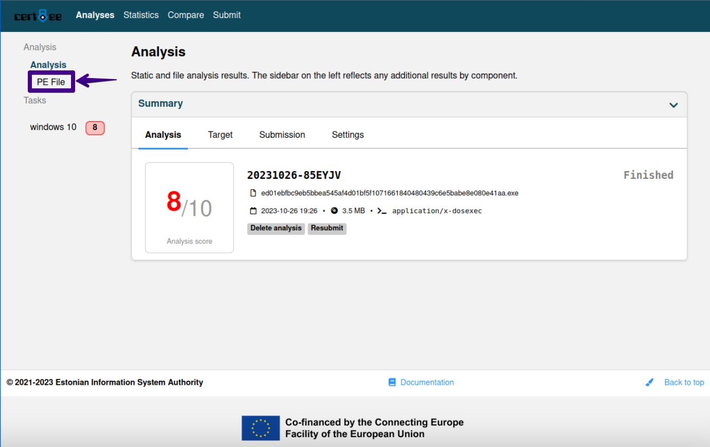
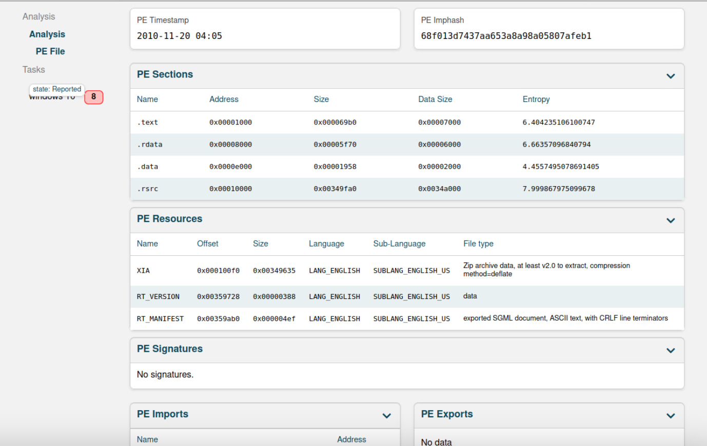

# SEC-455 Lab: Use ChatGPT and Cuckoo Sandbox to Analyze Malware

## Overview

This lab used [Cuckoo Sandbox](https://cuckoo.readthedocs.io/) 3 (hosted by CERT-EE, the Estonian Information System Authority) to perform automated dynamic and static analysis of a live WannaCry ransomware sample, and used ChatGPT as an assistant for explaining the Cuckoo analysis workflow. The activity was completed in an authorized cyber-lab environment (ACI Learning Skill Labs, VM `ai-ml-cuckoo3`, Kali Linux) for SEC-455, Security Operations Center.

## Learning Objectives

- Gain practical experience analyzing and understanding the behavior of a live ransomware sample.
- Monitor and analyze malware behavior in a controlled, isolated sandbox.
- Use ChatGPT to explain and contextualize a malware-analysis workflow.
- Use Cuckoo Sandbox to submit a sample and interpret static (PE) and dynamic (IOC, screenshot, memory) analysis results.

## Tools and Environment

- Kali Linux lab VM (`ai-ml-cuckoo3`)
- ChatGPT (workflow guidance)
- Cuckoo Sandbox 3, hosted instance operated by CERT-EE / Estonian Information System Authority
- Malware source: [theZoo](https://github.com/ytisf/theZoo) — "A repository of LIVE malwares for your own joy and pleasure," `malware/Binaries/Ransomware.WannaCry`
- Sample analyzed: `ed01ebfbc9eb5bbea545af4d01bf5f1071661840480439c6e5babe8e080e41aa.exe` (filename is the sample's own SHA-256 hash — a common theZoo convention), delivered inside the password-protected archive `Ransomware.WannaCry.zip`

## Lab Walkthrough

1. Asked ChatGPT how to analyze malware in Cuckoo; it summarized the standard workflow (set up, configure, submit, monitor execution, analyze results, extract IOCs, document findings).
2. Configured and launched Cuckoo 3 on the lab VM, confirmed the dashboard was reachable.
3. Cloned `theZoo` (`git clone https://github.com/ytisf/theZoo`) and navigated to `malware/Binaries/Ransomware.WannaCry`.
4. Extracted and submitted the WannaCry sample to Cuckoo 3 for analysis.
5. Waited for the analysis task (Windows 10 analysis VM) to finish, then reviewed the automatically generated report — 25 detected IOCs consistent with WannaCry ransomware behavior, plus captured screenshots including Command Prompt activity.
6. Opened the **Analysis → PE File** tab to review static PE details of the dumped/analyzed binary.

## Challenge Questions and Answers

| # | Question | Answer | Status |
| --- | --- | --- | --- |
| 1 | What is the name of the VM you just launched? | `ai-ml-cuckoo3` | Submitted — confirmed correct |
| 2 | What are the copyright years on the web site? (xxxx-xxxx) | `2021-2023` | Determined from the Cuckoo 3 dashboard footer ("© 2021-2023 Estonian Information System Authority"); the lab section advanced before this could be submitted |
| 3 | What is the name of the malware library? | `theZoo` | Submitted — confirmed correct |
| 4 | What is the name of the memory dump on the site? | `PE file` | Submitted — confirmed correct. The lab's own walkthrough labels the tab used "to review the memory dump of the VM" as **PE file**, so the expected answer is that tab name rather than a technical artifact. Two earlier guesses (`memory.dmp`, the generic Cuckoo term, and `XIA`, an embedded PE resource name) were marked incorrect first. |

*Figure 1. Cuckoo 3 Analysis summary tab — analysis ID `20231026-85EYJV`, score 8/10, submitted file `ed01ebfbc9eb5bbea545af4d01bf5f1071661840480439c6e5babe8e080e41aa.exe`, and the "© 2021-2023 Estonian Information System Authority" footer used for Challenge #2.*

*Figure 2. Cuckoo 3 PE File tab — the section the lab identifies as "the memory dump of the VM" and the correct answer to Challenge #4. Shows PE timestamp, Imphash (`68f013d7437aa653a8a98a05807afeb1`), sections, and resources (including an `XIA` resource identified as deflate-compressed Zip archive data).*

## Discussion Questions and Answers

**What are the two ways of analyzing malware in Cuckoo?**
Static analysis (examining the file itself — PE headers, imports/exports, sections, resources, hashes — without executing it) and dynamic analysis (executing the sample in an isolated sandbox VM and observing its runtime behavior, such as file, registry, network, and process activity).

**What is theZoo?**
[theZoo](https://github.com/ytisf/theZoo) is an open-source repository of live, real malware samples maintained for research and education. It hosts categorized families (e.g., `Ransomware.WannaCry`) as password-protected archives so analysts can safely obtain samples for controlled sandbox analysis.

## MITRE ATT&CK Mapping (WannaCry)

| Tactic | Technique | Relevance |
| --- | --- | --- |
| Lateral Movement | [T1210: Exploitation of Remote Services](https://attack.mitre.org/techniques/T1210/) | WannaCry propagated across SMBv1 using the EternalBlue exploit (MS17-010). |
| Defense Evasion | [T1027: Obfuscated/Compressed Files or Information](https://attack.mitre.org/techniques/T1027/) | The submitted binary embeds a deflate-compressed Zip resource (`XIA`) containing the ransomware's payload components. |
| Impact | [T1486: Data Encrypted for Impact](https://attack.mitre.org/techniques/T1486/) | Core ransomware behavior — encrypts victim files and demands payment. |
| Impact | [T1489: Service Stop](https://attack.mitre.org/techniques/T1489/) | WannaCry variants disable or interfere with security-related services during execution. |

## Defensive Recommendations

- Patch SMBv1 (MS17-010) and disable SMBv1 entirely where not required.
- Segment networks to limit SMB lateral movement between hosts.
- Maintain offline, tested backups to recover from ransomware encryption without paying a ransom.
- Deploy EDR/antivirus with behavioral detection for ransomware-style mass file encryption, not just signature matching.
- Monitor for anomalous SMB traffic and known EternalBlue indicators at the network boundary and internally.
- Analyze unknown binaries in an isolated sandbox (as done here) before allowing execution on production systems.

## Evidence

- `evidence/cuckoo3-analysis-overview.png` — Cuckoo 3 Analysis summary tab (filename, score, dashboard footer).
- `evidence/cuckoo3-pe-file-analysis.png` — Cuckoo 3 PE File static analysis tab (timestamp, Imphash, sections, resources).

No raw malware binaries are included in this repository — only sanitized analysis-report screenshots from the sandboxed Cuckoo 3 instance.

## Conclusion

This lab combined AI-assisted guidance (ChatGPT) with automated sandbox analysis (Cuckoo 3) to investigate a real WannaCry ransomware sample sourced from theZoo. The exercise reinforced the distinction between static and dynamic malware analysis and showed how a Cuckoo report surfaces both file-level (PE) and behavior-level (IOC) indicators. All four challenge questions were ultimately answered correctly; the trickiest was Challenge #4, whose answer (`PE file`) turned out to be the lab's own name for the tab used to review the VM's memory dump — a reminder to check the walkthrough's exact wording before over-analyzing the underlying technical data.

## Authorized Use

This material documents an authorized educational lab (ACI Learning Skill Labs / DeVry University SEC-455). It is intended for defensive-security learning only. The analyzed sample is a well-documented, publicly cataloged WannaCry variant handled entirely within an isolated sandbox environment.

## References

- [theZoo — A repository of LIVE malwares](https://github.com/ytisf/theZoo)
- [Cuckoo Sandbox — Analysis Results documentation](https://cuckoo.readthedocs.io/en/latest/usage/results/)
- [WannaCry sample analysis referencing the same SHA-256 filename](https://github.com/alby0304/WannaCry_Analysis)
- [Dissecting WannaCry samples](https://dissectingmalwa.re/third-times-the-charm-analysing-wannacry-samples.html)
- [MITRE ATT&CK: T1210 — Exploitation of Remote Services](https://attack.mitre.org/techniques/T1210/)
- [MITRE ATT&CK: T1027 — Obfuscated/Compressed Files or Information](https://attack.mitre.org/techniques/T1027/)
- [MITRE ATT&CK: T1486 — Data Encrypted for Impact](https://attack.mitre.org/techniques/T1486/)
- [MITRE ATT&CK: T1489 — Service Stop](https://attack.mitre.org/techniques/T1489/)
