# SEC335 Module 1 — Incident Response Procedures, Forensics, and Forensic Analysis

**Author:** ImResilience-dev  
**Course:** DeVry University, SEC335  
**Lab status:** Completed  
**Focus:** Network reconnaissance, credential attacks, Windows live response, and FTP log analysis

## Overview

I completed this lab from both sides of an incident: first as an attacker identifying exposed services and recovering a weak credential, then as an incident responder collecting host information and examining authentication logs.

I used Nmap and Zenmap to investigate the lab's external interface, Bruter to perform an FTP dictionary attack, and Remote Desktop to access the Windows Server with the recovered account. I then switched to the server console, used the supplied incident response tools to collect system information into a report, calculated a file hash, and reviewed the FTP logs for failed and successful authentication.

The exercise showed me how an exposed service and weak administrative credential can create a path to remote access—and how a responder can use network connections, processes, accounts, and logs to investigate that activity.

## Lab environment

I worked within the course's isolated network. The external address represented the lab firewall; the Windows Server was on the internal network.

| Component | Lab role / address |
|---|---|
| Windows 8.1 | External attack workstation, 175.45.176.200 |
| pfSense | External interface: 203.0.113.100; LAN interface: 192.168.1.254 |
| Windows Server 2008 | Internal target, 192.168.1.10 |
| Metasploitable | Additional internal host, 192.168.1.30 |
| IR_TOOLS (E:) | Supplied incident response toolset |

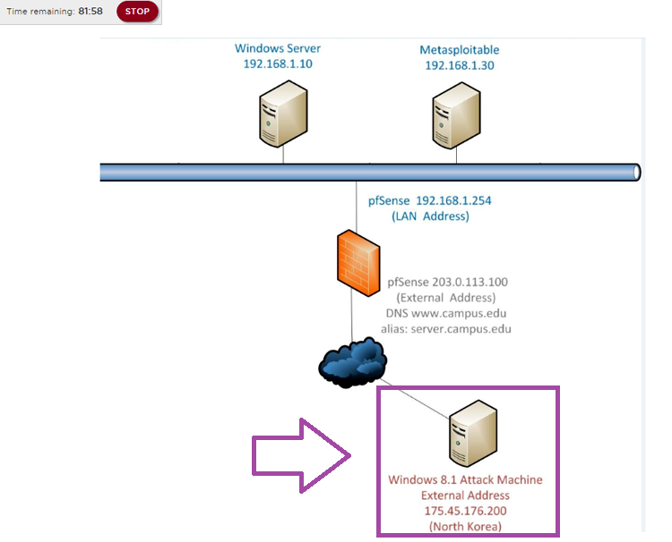

*Figure 1. Course topology showing the external workstation, firewall, and internal hosts.*

The course reference figures illustrate the lab workflow; my session log captures appear in the log-analysis section. The [screenshot index](evidence/README.md) identifies both sets. Credentials and challenge answers are redacted.

## 1. Reconnaissance: identifying exposed services

I began from the external Windows workstation with a basic Nmap scan:

```cmd
nmap 203.0.113.100
```

My purpose was to identify reachable services before selecting an attack path. An open port indicates that a service accepted probes; identifying its software requires additional service detection.

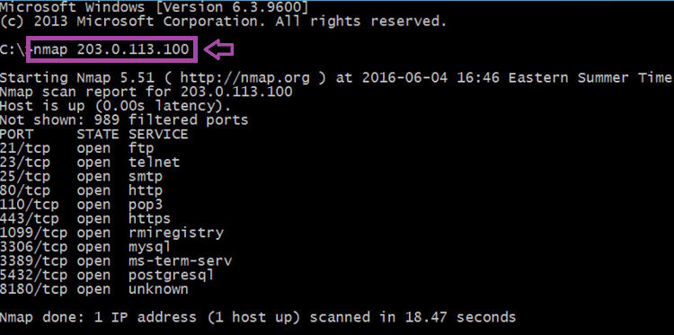

*Figure 2. Basic scan output from the course reference.*

I then launched Zenmap, entered the same target, and selected the **Intense scan** profile. The displayed command was:

```cmd
nmap -T4 -A -v 203.0.113.100
```

I used the **Ports / Hosts** view to connect port numbers with service-detection results. Zenmap is Nmap's [official graphical interface](https://nmap.org/zenmap/); it made the scan configuration and results easier to review.

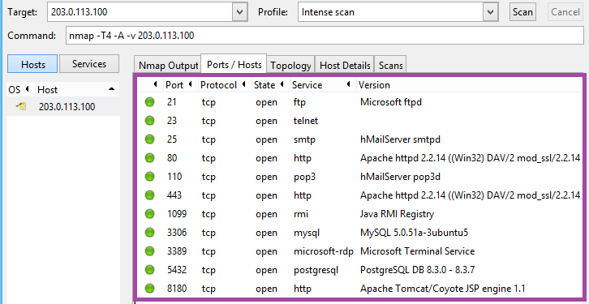

*Figure 3. Service detection in the supplied lab reference.*

The lab reference displayed the following exposed services:

| TCP port | Service shown | Investigative significance |
|---|---|---|
| 21 | Microsoft FTP | Authentication endpoint used for the dictionary exercise |
| 23 | Telnet | Additional remote-access exposure |
| 25 / 110 | SMTP / POP3 | Mail services |
| 80 / 443 | Apache HTTP services | Web-facing attack surface |
| 1099 | Java RMI Registry | Additional remotely reachable service |
| 3306 | MySQL | Database exposure |
| 3389 | Microsoft Terminal Service | Remote Desktop endpoint |
| 5432 | PostgreSQL | Database exposure |
| 8180 | Apache Tomcat / Coyote | Additional web application service |

I focused on FTP and RDP because they formed the access path exercised in this lab. The scan also reinforced the value of reducing unnecessary services at a network boundary.

## 2. Credential attack: testing the FTP administrator account

I configured Bruter with the external target, **FTP**, port **21**, the **administrator** account, and the supplied **Wordlist.txt** dictionary. I started the test and used its result to obtain the lab account credential.

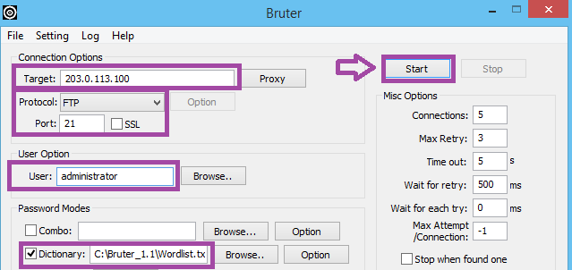

*Figure 4. Target, protocol, account, and dictionary configuration.*

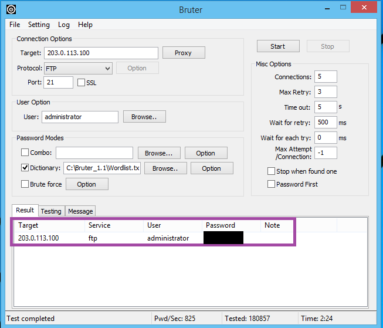

*Figure 5. Completed dictionary-test result. The recovered password is intentionally covered.*

This was a dictionary attack: Bruter tested candidate passwords from a list against the FTP service. It did not require exploitation of a software vulnerability. The weakness was an administrative credential that could be guessed through an exposed authentication service.

This step helped me connect password policy to practical risk. A privileged account increases the impact of a successful guess, especially when the same credential is accepted by another remote-access service.

## 3. Remote access: using the recovered credential

I checked RDP exposure with a targeted scan:

```cmd
nmap 203.0.113.100 -p 3389
```

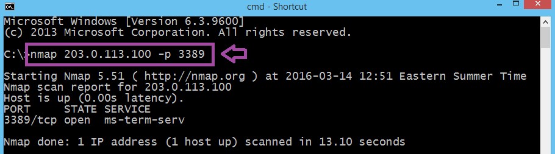

*Figure 6. RDP port check in the course reference.*

I launched the Windows Remote Desktop client with **mstsc**, connected to the lab's external address, and authenticated with the recovered administrator credential. This opened the Windows Server desktop.

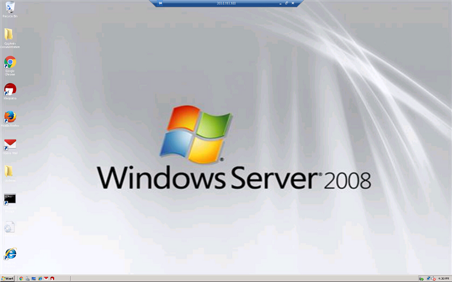

*Figure 7. Remote Windows Server desktop shown in the lab workflow.*

The important result was the transition from credential recovery over FTP to interactive access through RDP. I demonstrated why protecting each service separately is insufficient when a privileged credential provides access across services.

## 4. Incident response: collecting host information

I switched from the attack workstation to the Windows Server console and opened **cmd.exe** from **IR_TOOLS (E:)**. I set and displayed the command search path:

```cmd
PATH=E:\
PATH
```

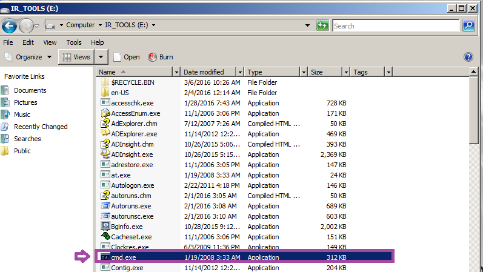

*Figure 8. Supplied response tools and command shell on the E: drive.*

Using the supplied toolset reduced reliance on executables installed on the host. Setting PATH directed command lookup toward that tool directory; it was not, by itself, a guarantee that the host or every executable was trustworthy.

### Creating the collection record

I created **IR.TXT**, recorded the responder label, and appended the collection date and time:

```cmd
echo Incident Responder Student > IR.TXT
date /t >> IR.TXT
time /t >> IR.TXT
```

The distinction between the redirection operators mattered: **>** created or replaced the file, while **>>** appended subsequent results. I used **type IR.TXT** to review the accumulated output.

### Collecting network, process, and account information

I followed this collection sequence:

| Command | Information I collected | Why it mattered |
|---|---|---|
| ipconfig /all | Adapter configuration, IP and MAC addresses, gateway, and DNS settings | Established the host's network identity and configuration |
| netstat -ano | Connections, listening endpoints, numerical addresses, and owning PIDs | Supported connection-to-process correlation |
| tasklist | Running processes and their PIDs | Provided process context for network activity |
| psloggedon | Local and resource-share logon information | Helped identify accounts associated with host access |
| net user | Local account list | Supported review of available accounts |
| time /t | Closing time entry | Marked the end of the collection sequence |

```cmd
ipconfig /all >> IR.TXT
netstat -ano >> IR.TXT
tasklist >> IR.TXT
psloggedon >> IR.TXT
net user >> IR.TXT
time /t >> IR.TXT
```

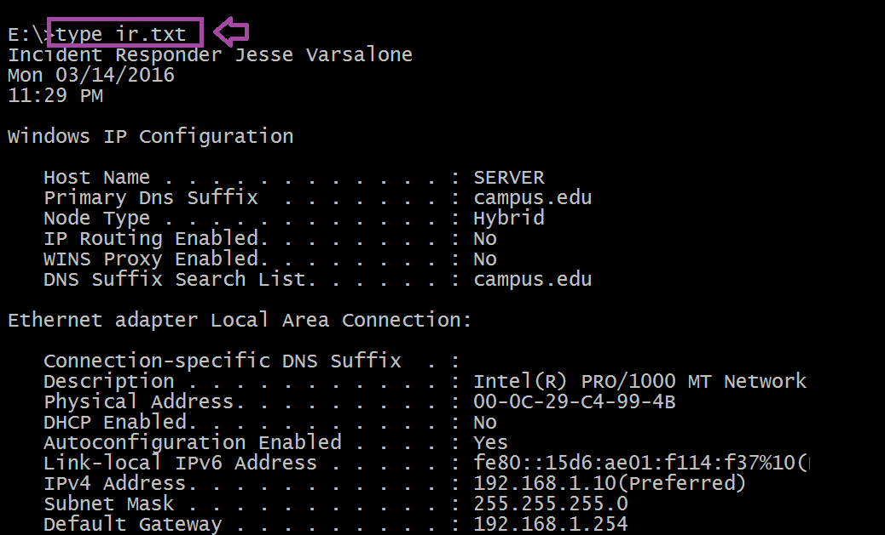

*Figure 9. Course example of the collected network configuration. The responder name and date belong to the course example.*

I used these filters to review relevant entries:

```cmd
type IR.TXT | find "3389"
type IR.TXT | find "svchost"
type IR.TXT | find "administrator"
type IR.TXT | find "Guest"
```

For **netstat -ano**, **-a** includes active connections and listening ports, **-n** keeps addresses and ports numeric, and **-o** includes process IDs. I could use that PID to look up the associated process in tasklist. A listening RDP port describes exposure; an established connection describes an active connection. Those states answer different questions. See [Microsoft's netstat documentation](https://learn.microsoft.com/en-us/windows-server/administration/windows-commands/netstat).

I also learned to interpret the filters in context. An svchost entry is not inherently malicious, a Guest account listing does not establish that it is enabled, and PsLoggedOn is a snapshot rather than a complete logon history. [Microsoft's PsLoggedOn documentation](https://learn.microsoft.com/en-us/sysinternals/downloads/psloggedon) explains its local and resource-share logon reporting.

### Hashing the collection file

After completing the collection, I generated an MD5 digest of IR.TXT and saved the output separately:

```cmd
md5sum IR.TXT >> hash.txt
type hash.txt
```

The separate hash file gave me a reference for checking whether the collected file changed afterward. I completed the lab's MD5 procedure; for a modern evidence workflow, I would also record SHA-256 and maintain acquisition and transfer records. A matching file hash supports integrity checking, while custody documentation explains who handled the evidence and when.

## 5. Log analysis: examining the authentication trail

I navigated to:

```text
C:\Windows\System32\LogFiles\MSFTPSVC1
```

I opened the dated FTP log in Notepad and searched for **230** to locate successful logins. I compared successful responses with the repeated authentication failures surrounding the password exercise.

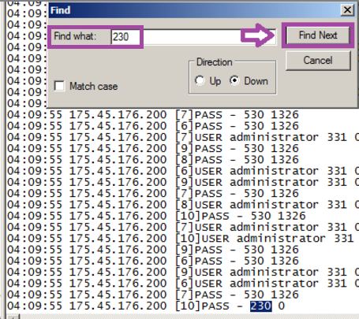

*Figure 10. Course reference showing repeated failures and a highlighted success response.*

### Interpreting the records

| Field / code | Meaning | How I used it |
|---|---|---|
| Timestamp | Recorded event time | Placed activity within each log's sequence |
| Client address | Recorded connection source | Grouped activity from the same source |
| Session identifier | FTP session context | Kept different sessions distinct |
| USER | Submitted account name | Identified the account being attempted |
| 331 | Password requested | Recognized an intermediate authentication response |
| 530 | Not logged in | Identified unsuccessful authentication |
| 230 | User logged in | Located successful authentication |
| 1326 | Windows logon failure status | Added context to the failed password attempts |

FTP reply meanings follow [RFC 959](https://datatracker.ietf.org/doc/html/rfc959).

### My session findings

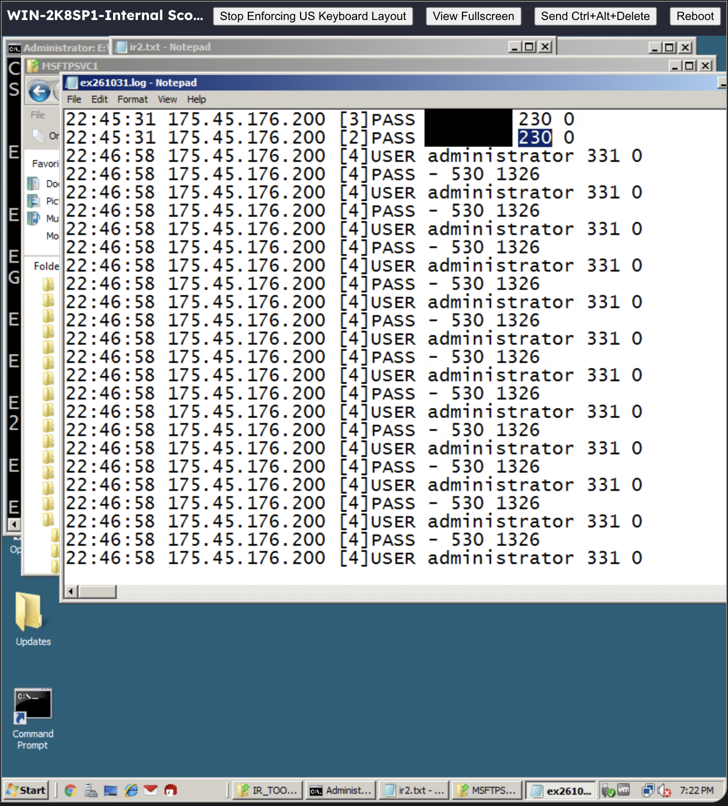

*Figure 11. My session capture of ex261031.log.*

In my dated log, I identified repeated **USER administrator** entries followed by **530 1326**, using the same recorded client address and session **[4]**, at **22:46:58**. The repeated failures were consistent with the password-guessing activity practiced in the lab.

I also found **230** responses at **22:45:31** in sessions **[2]** and **[3]**. I kept those earlier successes separate from the later administrator failures. To reconstruct an individual login, I would match its USER and PASS records within the same session.

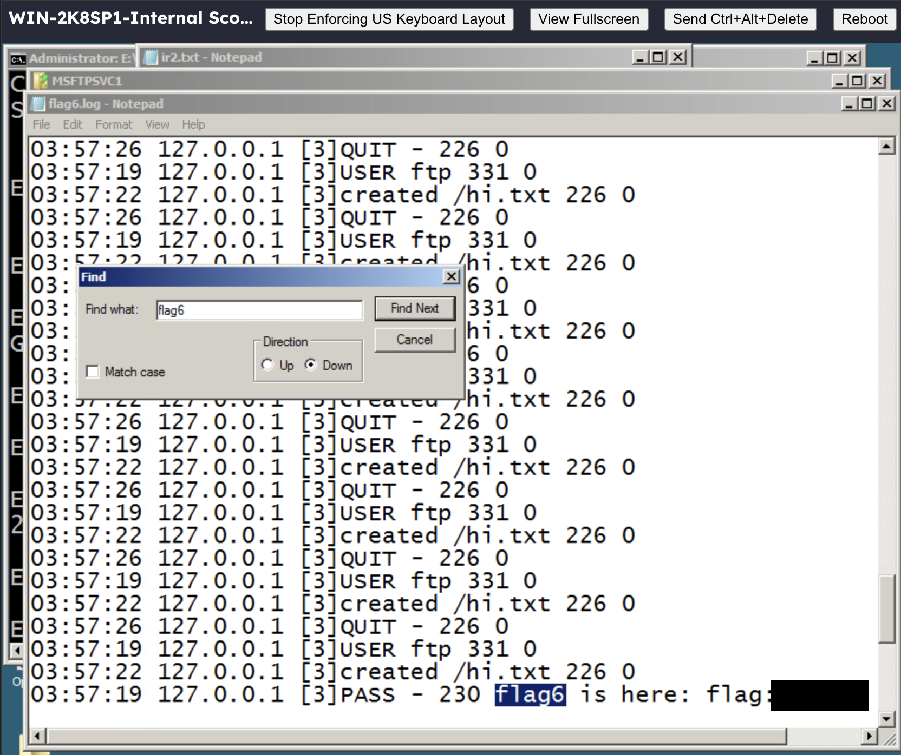

*Figure 12. My session capture of flag6.log.*

The challenge log contained a successful response from **127.0.0.1**, the loopback address. I treated that as local lab activity, distinct from the externally sourced entries in the dated log.

This comparison was the key forensic lesson: a response code identifies the outcome of a particular event. The account, source, session, and time explain how that event fits the investigation. My RDP access was a separate stage of the exercise, rather than a conclusion drawn solely from an FTP success code.

## Discussion questions

| Question | My answer |
|---|---|
| What is the purpose of Nmap? | I used it to discover reachable services and investigate the network's exposed attack surface. |
| What is Zenmap? | Nmap's official graphical interface; I used its scan profile and service-results view. |
| What is the purpose of Bruter? | In this lab, I used it to test dictionary passwords against FTP authentication. |
| What is ipconfig? | A Windows command for viewing network configuration; /all provides detailed adapter information. |
| What is netstat? | A connection and endpoint inspection tool; I used -ano to include numerical endpoints and PIDs. |
| What is psloggedon? | A Sysinternals tool for reporting local and resource-share logons. |
| What is md5sum? | A utility that calculates an MD5 file digest for comparison during integrity checks. |
| Where are the logs located? | This lab's FTP logs were under C:\Windows\System32\LogFiles\MSFTPSVC1. Windows event logs are also accessible through Event Viewer. |
| What does MSFTPSVC1 contain? | FTP service logs with timestamps, client addresses, commands, session context, and response/status codes. |

## Defensive recommendations

The access path I exercised points to several practical controls:

- Restrict externally reachable services to those required, especially administrative access.
- Keep privileged accounts out of routine FTP use and protect them with strong, unique credentials.
- Apply rate limiting or appropriate lockout controls, and alert on repeated failures and unexpected successes.
- Place remote administration behind approved access controls and use MFA where supported.
- Preserve service and Windows authentication logs centrally to support correlation and retention.
- Maintain a prepared response toolset and a repeatable collection procedure; use supported systems and secure transfer protocols.

These recommendations follow from the exercise; the lab's hands-on response work focused on collection and analysis.

## Skills demonstrated and interview takeaway

I practiced network discovery, service interpretation, dictionary-attack testing, Remote Desktop access, Windows live-response collection, output redirection, file hashing, and authentication-log analysis.

My main takeaway is that collecting output is only the first step. I need to explain what each artifact means and connect it to the right question: what was exposed, how access was obtained, what the host was doing, and what the logs recorded.

**How I would explain this lab in an interview:** I identified FTP and RDP exposure in an isolated network, recovered a weak administrative credential through a dictionary exercise, and used it for remote access. I then switched to incident response, collected host and connection information with the supplied tools, hashed the collection file, and reviewed FTP authentication records. The exercise taught me to connect the attack path to host evidence while keeping accounts, sessions, and event outcomes distinct.
