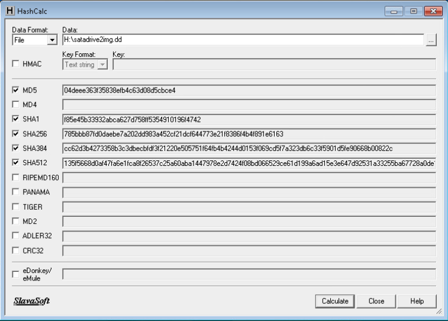
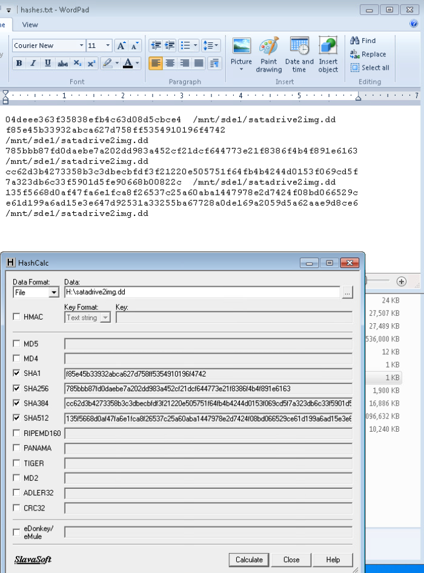

# SEC335 Module 2 — Hashing Data Sets

**Author:** ImResilience-dev  
**Course:** DeVry University · SEC335, Incident Response and Digital Forensics  
**Environment:** Authorized educational Windows 7 / Kali Linux lab  
**Report prepared:** November 8, 2026  
**Evidence status:** Screenshot-supported HashCalc comparison; acquisition workflows documented from the supplied walkthrough.

## Overview

This lab explores how forensic examiners acquire disk images and compare cryptographic hashes to assess data consistency. It connects three workflows: EnCase forensic imaging and MD5/SHA-1 verification, a raw disk acquisition with Kali's `dd`, and a Windows HashCalc comparison against a saved hash log.

The strongest retained evidence is the pair of supplied HashCalc/WordPad screenshots. Their displayed MD5, SHA-1, SHA-256, and SHA-384 values agree across the relevant views. SHA-512 is calculated in HashCalc, but the field is clipped, preventing a complete comparison. These observations support consistency between the displayed results; they do not independently establish that a source disk and its image were identical.

## Scope and evidence standard

I distinguish visible results from the procedure and prior progress descriptions. Commands below document the supplied exercise; they are not a claim that this report's preparation reran the lab.

| Evidence | What it supports | What it does not establish |
|---|---|---|
| E1 — HashCalc results | File input `H:\satadrive2img.dd`; five selected algorithms and populated result fields; HMAC unchecked | Successful acquisition, source-disk hashes, or an independently recomputed digest |
| E2 — WordPad and HashCalc | `hashes.txt` shows five digest entries for `/mnt/sde1/satadrive2img.dd`; visible comparisons described below | How the text file was generated, unbroken custody, or the identity of the underlying disk |
| Supplied EnCase/Kali walkthrough | Intended tools, devices, commands, and verification sequence | Personal execution or successful completion of each step |
| Earlier conversation progress descriptions | Reported EnCase verification and Kali imaging/hashing progress | Independent confirmation; earlier assistant interpretations are secondary descriptions |

No lab grade, challenge acceptance, acquisition duration, source serial number, or error-free `dd` run is inferred. Screenshot filename times are labels, not validated acquisition timestamps.

## 1. EnCase: acquisition and verification methodology

The supplied workflow uses EnCase Forensic Imager on the Windows lab VM. The procedure selects the lab disk, creates an evidence image with MD5 and SHA-1 enabled, then reloads the image to verify its acquired data.

1. Add the local evidence device and confirm the intended source disk before acquisition.
2. Set the case/evidence labels and a separate destination. Select the lab's **Legacy E01** format and both **MD5** and **SHA-1**.
3. Complete acquisition and inspect **View → Console** for acquisition messages and recorded digests.
4. Remove the device from the view and reopen the resulting evidence file. Use the filename actually created: the supplied material inconsistently references `.Ex01` and `.E01`.
5. Review the **Report** tab, run **Device → Hash**, and compare acquisition and verification digests for each algorithm.
6. Retain both sets of values and any verification errors with the acquisition record.

The comparison must use the acquired evidence data as interpreted by the forensic tool. Hashing the entire E01 container as an ordinary file is a different operation: container headers and metadata mean that digest should not be assumed to equal a raw source-disk digest.

**Evidence limit:** Earlier conversation descriptions report matching EnCase MD5/SHA-1 values, but also raise uncertainty about whether the image shown was a historical course example. The two screenshots published here contain no EnCase acquisition or verification output. This report therefore documents the method without asserting a personally verified EnCase result or copying unverified digest values.

## 2. Kali: raw imaging and multi-algorithm hashing

The walkthrough boots the Windows VM into Kali Live, inventories devices, mounts a separate NTFS destination, and copies the lab source disk to a raw image. These device names are specific to that exercise and must be checked before reuse.

```bash
# Supplied lab device layout — confirm source and destination first.
fdisk -l | grep sd
mkdir /mnt/sde1
ntfs-3g /dev/sde1 /mnt/sde1
mount | grep sde

# Read the whole lab source disk and write a raw image to separate media.
dd if=/dev/sdc of=/mnt/sde1/satadrive2img.dd
```

`if` identifies the input; `of` identifies the output. The intended source is the whole disk `/dev/sdc`, not its partition `/dev/sdc1`. A whole-disk digest must be compared with the corresponding whole-disk image, rather than a partition or an individual file. The published screenshots do not show the `dd` completion summary, byte count, or read-error status.

The source/image comparisons in the walkthrough are:

```bash
md5sum /dev/sdc
md5sum /mnt/sde1/satadrive2img.dd
sha1sum /dev/sdc && sha1sum /mnt/sde1/satadrive2img.dd
sha256sum /dev/sdc && sha256sum /mnt/sde1/satadrive2img.dd
sha384sum /dev/sdc && sha384sum /mnt/sde1/satadrive2img.dd
sha512sum /dev/sdc && sha512sum /mnt/sde1/satadrive2img.dd
```

Each source digest should equal its image digest for the same algorithm and byte scope. `&&` runs the second command only if the first succeeds; the operations are sequential. The source-device outputs are not present in E1/E2, so this source/image equality remains unverified here.

The walkthrough preserves image digests in a text file:

```bash
md5sum /mnt/sde1/satadrive2img.dd >> /mnt/sde1/hashes.txt
sha1sum /mnt/sde1/satadrive2img.dd >> /mnt/sde1/hashes.txt
sha256sum /mnt/sde1/satadrive2img.dd >> /mnt/sde1/hashes.txt
sha384sum /mnt/sde1/satadrive2img.dd >> /mnt/sde1/hashes.txt
sha512sum /mnt/sde1/satadrive2img.dd >> /mnt/sde1/hashes.txt
cat /mnt/sde1/hashes.txt
```

`>>` appends, so repeating the sequence can duplicate entries. E2 visibly contains the resulting style of log, but a WordPad view alone cannot authenticate its command history.

**Preservation lesson:** Booting live media alone is not proof that source media stayed unchanged. Kali documents disabled automounting specifically for its [forensic boot mode](https://www.kali.org/docs/general-use/kali-linux-forensics-mode/). The supplied walkthrough later mounts the source partition without an explicit read-only option to inspect a challenge file; that step is not evidence-preserving practice. In an investigation, use validated write protection and examine a working image or a controlled read-only mount. No challenge answers are published here.

## 3. HashCalc: comparing the saved results

The screenshots show HashCalc in **File** mode with `H:\satadrive2img.dd` selected. In E1, MD5, SHA1, SHA256, SHA384, and SHA512 are checked and populated. E2 places `hashes.txt` in WordPad above HashCalc, enabling direct visual comparison. In E2, MD5 is unchecked and blank in HashCalc; its comparison uses E1 instead.

The Windows and Linux paths are consistent with the walkthrough's destination mapping, but paths alone do not prove that both tools read the same underlying file.



*Figure 1 — E1. Five selected hash algorithms with populated results. The SHA-512 field extends beyond the visible text area.*



*Figure 2 — E2. Saved digest text and the HashCalc comparison view. Long lines in WordPad wrap; wrapped lines are not additional digest entries.*

### Observed results

The following are manual transcriptions of fully readable values, not new calculations against the disk image:

| Algorithm | Displayed digest | Screenshot comparison |
|---|---|---|
| MD5 | `04deee363f35838efb4c63d08d5cbce4` | E1 HashCalc agrees with E2 WordPad |
| SHA-1 | `f85e45b33932abca627d758ff5354910196f4742` | Full agreement in E1/E2 |
| SHA-256 | `785bbb87fd0daebe7a202dd983a452cf21dcf644773e21f8386f4b4f891e6163` | Full agreement in E1/E2 |

SHA-384 is fully visible in E1 and the wrapped WordPad entry in E2; those values agree. SHA-512 has a complete wrapped entry in WordPad, but both HashCalc views clip its suffix. Only the visible portion agrees; a full SHA-512 match is not claimed.

The SHA-1 and SHA-256 comparisons are the clearest same-screen demonstrations in E2. The MD5 comparison spans two captures. None of these comparisons supplies the missing `/dev/sdc` digest results.

## Interpretation and lessons learned

A matching digest supports consistency of the compared data under that algorithm. It does not establish who created the data, that the original disk was trustworthy, or that evidence was never mishandled. The baseline digest and custody record must themselves be preserved.

MD5 and SHA-1 are included because the historical lab requires them. Digest length is not a measure of “accuracy,” and SHA-1 is not simply a more accurate MD5. For new security-sensitive verification, use an appropriate modern algorithm such as SHA-256; [NIST recommends replacing SHA-1 with SHA-2 or SHA-3](https://www.nist.gov/news-events/news/2022/12/nist-retires-sha-1-cryptographic-algorithm).

The most useful skills practiced by this exercise are choosing the correct acquisition scope, distinguishing a raw image from an evidence container, preserving digest records, and making conclusions proportional to the available evidence. My portfolio takeaway is to explain exactly what matched and identify the artifacts still needed to validate the acquisition.

## Evidence handling and remaining validation

The [evidence record](evidence/README.md) documents crops and publication hashes. The published images retain the relevant tool output while excluding the VM toolbar, desktop challenge-file icons, and unrelated desktop context. No credentials, personal identifiers, or challenge values are included.

To strengthen this record, retain the original disk/image, EnCase acquisition and verification reports, complete Kali command output with source/image digests and acquisition byte counts, tool versions, write-protection details, and custody timestamps. A full-width SHA-512 export would resolve the clipped comparison. Those artifacts were unavailable for this report; no results are invented to replace them.

**Source material:** User-supplied SEC335 “Hashing Data Sets” walkthrough and two uploaded HashCalc/WordPad screenshots. Course illustration URLs and earlier assistant summaries are not treated as the learner's execution evidence. Technical clarifications are linked above. This report documents an educational lab, not a production forensic case or a certification award.
