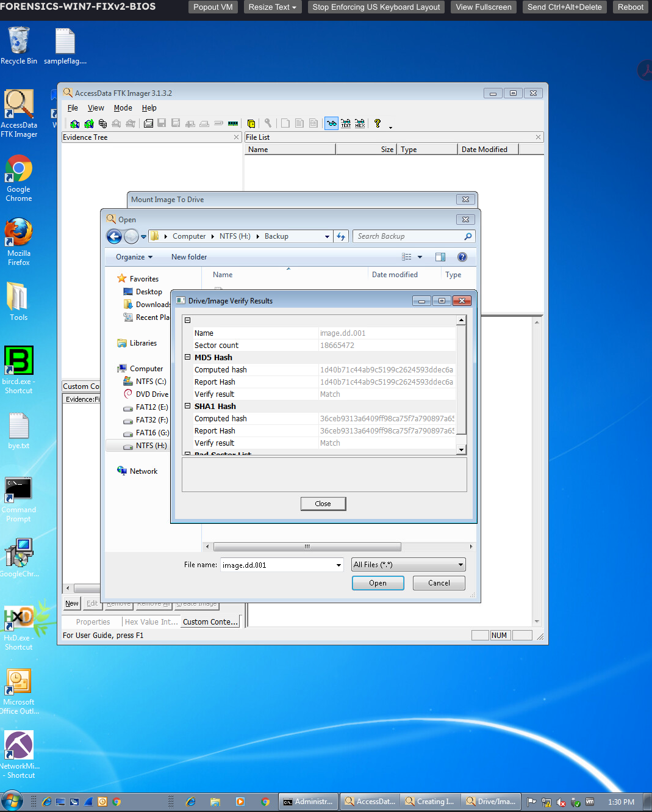

# Digital Forensics Lab Report: The Imaging Process

**Course:** SEC335 — Incident Response and Digital Forensics  
**Institution:** DeVry University  
**Module:** 2 — Forensic Methodologies and Tools  
**Lab:** The Imaging Process  
**Completion Date:** November 8, 2026  
**Lab Environment:** Windows 7 and Kali Linux virtual machines  
**Status:** Completed (learner reported); evidence review below
**Author:** ImResilience-dev

> Portfolio edition based on the complete prior draft (WritingBlock 62483), checked against the supplied FTK/Windows dd/Kali instructions and two learner screenshots. Procedures and observed outcomes are distinguished below. Challenge answers are omitted.

---

## 1. Executive Summary

This lab explored forensic disk acquisition using both graphical and command-line tools. The objective was to create forensic images while protecting the original evidence and understanding the importance of verifying data integrity.

I worked with AccessData FTK Imager on Windows 7, the Windows implementation of `dd`, and the Linux utilities `dd` and `dcfldd` in Kali Linux.

The exercises demonstrated how forensic imaging differs from ordinary file copying, why investigators should examine acquired images rather than original evidence, and how acquisition methods can affect the reliability of an investigation.

## 2. Lab Objectives

The primary objectives were to:

- Create a forensic image using FTK Imager.
- Verify the acquired image using cryptographic hash values.
- Mount an acquired image in read-only mode for examination.
- Practice command-line imaging using `dd`.
- Use Kali Linux to acquire physical storage devices.
- Compare the functionality of `dd` and `dcfldd`.
- Preserve digital evidence using established forensic procedures.

## 3. Tools and Environment

| Tool | Purpose |
|---|---|
| Windows 7 | Windows-based forensic acquisition environment |
| FTK Imager 3.1.3.2 (screenshot; walkthrough installer 3.1.3) | Logical-drive imaging and integrity verification |
| Windows dd | Command-line disk acquisition |
| Kali Linux | Live Linux forensic environment |
| dd | Bit-level acquisition of storage devices |
| dcfldd | Enhanced imaging utility with hashing and progress-reporting capabilities |
| MD5 and SHA-1 | Hash algorithms used in the FTK verification exercise |
| Sigcheck | Examination of file hashes on mounted image data |

All practical activities were conducted within the course's authorized virtual lab environment.

## 4. Methodology

### Phase 1 — Forensic Acquisition with FTK Imager

I began by working with AccessData FTK Imager in the Windows 7 virtual machine.

The exercise required creating an image of the NTFS logical drive and storing it on a separate destination volume.

The walkthrough specified the following acquisition configuration; the retained screenshot confirms the generated filename and verification results, but does not display all configuration fields:

- Source: `C:\` — NTFS logical volume (walkthrough)
- Case number: `Lab05`
- Evidence number: `01`
- Description: `win7drive`
- Examiner: `student`
- Image type: Raw (dd)
- Destination directory: `H:\Backup`
- Generated image: `image.dd.001`

After acquisition, I reviewed FTK Imager's verification results.

Both the MD5 and SHA-1 computed hashes matched the corresponding recorded hashes.

The image verification output also reported a sector count of 18,665,472.

These matching results support the conclusion that the acquired image passed FTK Imager's integrity checks.

The walkthrough additionally covered mounting the image as a read-only logical drive (`I:`), then running `sigcheck -h I:\\*.txt`. The retained screenshot shows the mounting workflow open, but does not establish that the read-only mount or Sigcheck step completed. Read-only examination is important because investigators should avoid introducing changes to acquired evidence.

### Phase 2 — Windows Command-Line Imaging

The second exercise introduced the Windows implementation of `dd`.

The purpose was to understand how investigators can acquire data through a command-line utility without relying on a graphical imaging wizard.

The principal commands were:

```cmd
dd --list
```

This enumerates available devices and partitions.

```cmd
dd if=\\.\e: of="h:\image.dd" --progress bs=1024
```

This command instructs `dd` to copy data from the designated source volume to an image file on the destination drive.

The command components are:

- `if`: Input source.
- `of`: Output destination.
- `--progress`: Displays acquisition progress.
- `bs=1024`: Specifies the block size.

No retained learner screenshot confirms completion or file size for the Windows `dd` acquisition. This phase records the supplied procedure.

This exercise reinforced the importance of identifying source and destination devices correctly before acquisition.

### Phase 3 — Kali Linux Forensic Imaging

The third exercise involved booting into Kali Linux and working directly with storage devices.

The walkthrough identified devices with `fdisk -l | grep sd`, created `/mnt/sde1`, and mounted `/dev/sde1` using `ntfs-3g`. The learner screenshot shows a successful mount at `/mnt/sde1` after an earlier mountpoint error involving `/mnt/sed1`. It shows `/dev/sde1` mounted read/write as the destination.

The walkthrough prose inconsistently names `sda4` and `sdd1`; the commands and screenshot use `/mnt/sde1` and `/dev/sde1`. Device assignments are specific to this lab.

The screenshot showed successful execution of:

```bash
dd if=/dev/sdc of=/mnt/sde1/satadrive2img.dd
```

The terminal reported:

```text
20480+0 records in
20480+0 records out
10485760 bytes (10 MB, 10 MiB) copied
```

This confirmed that `dd` completed a 10 MiB copy from the designated source device.

I then worked with the enhanced imaging utility `dcfldd`.

An initial execution failed because the command name was mistyped. After correcting `dcflcc` to `dcfldd`, the utility produced acquisition output:

```bash
dcfldd if=/dev/sdd of=/mnt/sde1/satadrive2img.dd
```

The terminal reported:

```text
3072 blocks (96Mb) written.
3264+0 records in
3264+0 records out
```

This exercise demonstrated how `dcfldd` provides progress information during imaging. The displayed command includes no hashing option and the screenshot contains no acquisition digest. Progress and record counts alone do not verify source-to-image equality.

**Important observation:** Both commands used the same destination filename but different source devices. Consequently, the second operation could replace the image produced by the first. In an actual investigation, I would use separate destination filenames, record the exact source identifiers, and verify each image independently.

### Phase 4 — Evidence Examination and Challenge Completion

The final exercise required mounting a Linux partition and retrieving evidence from a file.

The relevant commands included:

```bash
mount /dev/sda1 /mnt/sda1
cat /mnt/sda1/1
```

The screenshot shows the final file content after command corrections. The challenge answer is omitted from this public report. An earlier mount attempt lacked a destination and returned an error; a later `mkdir` returned “File exists,” preventing the following `&&` commands from running. The final explicit mount and file-read command succeeded.

The learner reported the lab complete. No score or all-challenges acceptance screen is retained.

## 5. Results and Findings

| Activity | Result |
|---|---|
| FTK Imager acquisition | Completed |
| MD5 verification | Match |
| SHA-1 verification | Match |
| Windows dd acquisition | Procedure documented; no retained execution screenshot |
| Kali dd acquisition | Completed; 10 MiB copied |
| Kali dcfldd acquisition | Completed; progress output recorded |
| Final challenge flag | Retrieved |
| Overall lab | Completed, learner reported; grade and full challenge acceptance unverified |

The retained screenshots support FTK MD5/SHA-1 Match results and the displayed Kali copy operations. They do not confirm every walkthrough step, Windows dd completion, or a complete chain of custody.

The screenshots do not independently establish cryptographic hash values for the later Kali acquisitions. Those images would require their own verification records before being treated as independently validated forensic copies.

## 6. Forensic Analysis

### Evidence Integrity

Creating a forensic image allows an investigator to examine acquired data without repeatedly accessing the original storage device.

However, the imaging operation and verification process serve different purposes.

Acquisition preserves data from a source, while hash verification helps establish whether the acquired data remained consistent.

Matching hashes do not independently establish the identity of the person who created a file, the authenticity of its contents, or an uninterrupted chain of custody.

### Logical Versus Physical Acquisition

FTK Imager was used to acquire a selected logical volume.

The Kali Linux exercise demonstrated acquisition from physical device paths.

This distinction is significant because logical-volume acquisition and whole-device imaging can preserve different scopes of information.

The acquisition method must match the investigative objectives.

### Command-Line Imaging

The Windows and Linux `dd` exercises demonstrated the flexibility of command-line acquisition.

Command-line utilities can provide direct control over imaging operations. However, they also introduce risks if device identifiers or output paths are incorrect.

Careful command validation and documentation are therefore essential.

### Live and Offline Acquisition

The walkthrough contrasts live Windows acquisition with booting a Linux Live CD/DVD. Live acquisition can preserve access to an unlocked encrypted volume, while shutdown can lose keys or unlocked access. A live system also changes during acquisition; an offline method can reduce those changes. A bootable live environment alone does not establish write blocking. Acquisition decisions require documenting encryption state, volatile evidence, source protection, and intended scope.

### Tool Selection

FTK Imager offers a graphical workflow with built-in acquisition reporting and hash verification.

The `dd` utility provides straightforward bit-level copying, while `dcfldd` extends that functionality with forensic-oriented features.

Understanding several acquisition tools allows investigators to choose appropriate methods and independently validate findings where practical.

## 7. Challenges and Lessons Learned

One practical issue occurred when I initially entered an incorrect command name for `dcfldd`. The terminal returned a command-not-found error.

After correcting the spelling, the terminal displayed imaging record counts. Mount syntax and path corrections were also required, as documented above.

This was a useful reminder that command-line investigations require precision.

A second important observation concerned image destinations. Reusing the same output filename for separate acquisitions can overwrite evidence or cause confusion about which source an image represents.

A more defensible approach would involve unique evidence identifiers, separate image files, cryptographic verification, and complete acquisition documentation.

The greatest takeaway from this lab is that **creating a forensic image is only one part of evidence preservation**. The investigator must also validate the image, document the methods used, and maintain reliable evidence-handling records.

## 8. Conclusion

This lab strengthened my understanding of forensic acquisition through both graphical and command-line tools.

I practiced creating disk images with FTK Imager, `dd`, and `dcfldd`, examining acquisition output, and verifying integrity using cryptographic hashes.

The exercises reinforced the importance of selecting the correct acquisition method, preserving original evidence, and documenting every step.

These are foundational skills for digital forensics and incident response, especially when investigative findings must be reproducible and defensible.

## 9. Supporting Evidence

**Figure 1 — FTK Imager verification results (learner screenshot).** Both MD5 and SHA-1 verification results display **Match** for `image.dd.001`, sector count **18,665,472**. Some digest text is clipped; no complete digest is transcribed.



**Figure 2 — Kali acquisition and file retrieval (reviewed, withheld).** The supplied screenshot was inspected to verify the commands, 10 MiB copy, dcfldd record counts, and errors described above. It contains a challenge answer and is withheld from the public assets. It is not replaced with a fabricated screenshot.

See [evidence notes](evidence/README.md) for provenance and publication limits. The asset checksum verifies this portfolio file, not the acquired disk image.

## 10. References

- DeVry University. (n.d.). *The imaging process* [SEC335 virtual laboratory exercise]. Learner-provided FTK Imager, Windows dd, and Kali instructions in the referenced conversation.
- Learner-provided screenshots: FTK verification and Kali terminal, supplied with the November 8, 2026 lab discussion. Filename dates are labels, not independently validated acquisition timestamps.
